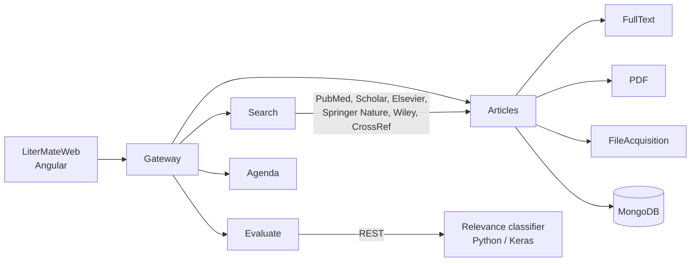

# NeuroMorpho.Org literature

This is the version of [PaperBot](https://github.com/NeuroMorphoOrg/PaperBot) that [NeuroMorpho.Org](https://neuromorpho.org) uses in production since 2020. NeuroMorpho.Org is the largest public database of digitally reconstructed neurons, and every neuron in it comes from a scientific paper. To keep it growing, someone has to find those papers, decide if they are relevant and contact the authors to ask for the data. Before, the curators did all of this by hand.

PaperBot is the generic version: an open-source tool that any lab can configure for its own field. I published it in *BMC Bioinformatics*: [PaperBot: open-source web-based search and metadata organization of scientific literature](https://doi.org/10.1186/s12859-019-2613-z) (2019). This repository is the version adapted to NeuroMorpho.Org, where I added full-text download, a deep learning classifier to decide if a paper is relevant, and the curation workflow around it.

## What it does

1. Searches the publisher portals and APIs with configurable keywords: PubMed, Google Scholar, Elsevier ScienceDirect, Springer Nature, Wiley and CrossRef.
2. Removes duplicates between sources, comparing titles, DOIs and authors with fuzzy matching.
3. Downloads the full text and the PDFs, and extracts sections, metadata and references.
4. Sends each paper to the relevance classifier ([TextRelevancy](https://github.com/p-maraver/TextRelevancy)). Papers classified with high confidence are processed automatically, and only around 5 in 100 need a person to review them.
5. Keeps track of the curation: the status of each paper, the contacts with the authors, the data requests and the database releases.

## Results

| | Before | With the pipeline |
|---|---|---|
| Papers processed per year | 800 | 5,775 |
| Expert time per relevant paper | 3.5 h | 1.7 h |
| Neurons published per year | 6,000 | over 41,000 |

These results are in *Brain Informatics*: [Automatic identification of scientific publications describing digital reconstructions of neural morphology](https://doi.org/10.1186/s40708-023-00202-x) (2023).

## Architecture

It is built as Java / Spring Boot microservices behind a gateway, with MongoDB to store the data and an Angular web application for the curators. Each service can be launched on its own.

| Module | What it does |
|---|---|
| `Search` | Connects to the portals, manages the keywords and logs the searches |
| `Articles` | Stores the papers, their status and removes duplicates |
| `FullText`, `PDF`, `FileAcquisition` | Download the full text and the PDFs and read them |
| `Metadata` | Extracts and groups the metadata |
| `Evaluate` | Calls the relevance classifier and applies the decision thresholds |
| `Agenda` | Manages the contacts with the authors and the emails to request the data |
| `ReconstructionsExpiration` | Follows the status of the requested reconstructions |
| `Release`, `ApiLiterature` | Database versions and the public literature API |
| `Gateway` | Single entry point for the web application |
| `LiterMateWeb` | Angular web application for the curators |

Stack: Java 8, Spring Boot 2.1, MongoDB, Angular 8 and Maven.

## Install

- Installation: [docs/Installation.md](docs/Installation.md)
- Databases: [docs/DBs.md](docs/DBs.md)
- API documentation: [apidoc/](apidoc/index.html)

## Author

Patricia Maraver. I designed and developed it during my PhD in Bioengineering at George Mason University (Krasnow Institute), in Giorgio A. Ascoli's lab.

## License

[Apache 2.0](LICENSE)
